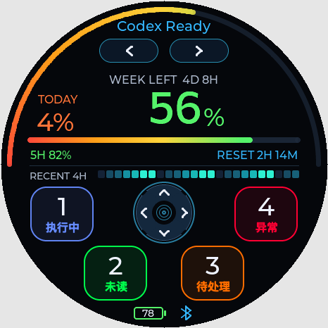
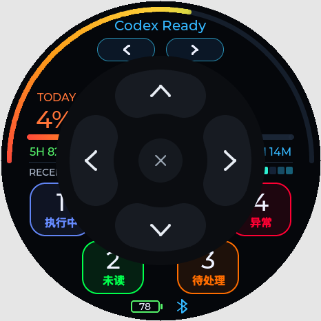
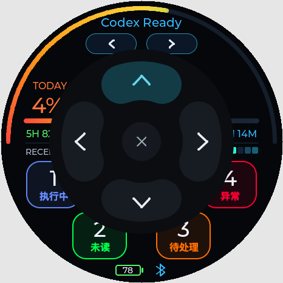

# Codex 弧形任务卡表盘

文档版本：1.8；最后更新：2026-10-15 20:24。

这是 OpenWatcher V2 的新布局，适配 466×466 圆屏。构建、刷写和实机验收分开记录，当前状态见 [PROJECT_STATE.md](../PROJECT_STATE.md)。

上图来自实际视图代码的主机渲染，使用示例数据，不是手表实拍。

## 操作

- 顶部左右方向按钮：不显示文字，不响应滑动。在左侧区域内松手发送一次左旋，右侧同理发送一次右旋；拖动、跨区、移出或开始录音都会取消。长按不会重复旋转。两侧中间留空隙。原生 Encoder 的实际功能跟随 Codex 的 Knob 配置，不修改主机映射。
- 四向方向盘：在小方向盘长按 0.2 秒，弹出居中的圆形面板；先松手，再短按上、右、下、左圆弧方向区。按下高亮并输出原生方向，松手归中，面板保留以便连续选择。中央 × 按下即关闭，面板外点击松手关闭。展开时不会直接选方向，拖动/跨区不会切换到另一方向；录音时自动收起。
- 任务卡 1–4：短触仅预览，按住约 0.28 秒提交一次原生槽位动作；确认前滑向另一卡片重新计时，确认后需松手才可提交下一次。执行中使用蓝色、未读绿色、待处理橙色、异常红色，均取自主机灯效；无状态为未知，未就绪为离线，自定义灯色标为状态。没有同步任务名称或当前选中任务的额外假设。
- A/B、A+B、Typeless/微信与 Codex Micro 输入模式沿用现有行为。录音时波形显示在方向盘位置；停止录音立即隐藏波形，恢复灰显方向盘，顶部显示 `PROCESSING`。识别完成后恢复方向盘亮度和触控；明确中断需重新录制。

## 信息布局

底部不再显示“四向长按 / 四向控制”或两个状态点。左侧为横向电池框，仅显示剩余电量数字、不带 `%`，≥30% 绿色、<30% 红色；右侧为简洁蓝牙图标，连接蓝色、断连红色加斜线。两图标等高、中心对齐，在圆屏内留出间距；与四向面板和语音状态独立显示。其他临时动作提示会短暂占用该行，提示结束恢复图标。

周剩余、Today 和独立 5H 剩余保留。5H 条内平滑地从红经橙、黄向绿过渡，长度表达剩余量；过期、缺失、越界时只显示轨道与 `--`。最近四小时的 24 个十分钟活动格按时间从左向右排列。低额仍为被动显示，不新增声音或振动提醒。

卡片大小为 90×78 px，中心依次为 `(88,304)`、`(164,388)`、`(302,388)`、`(378,304)`，四角均在圆屏内。方向盘中心为 `(233,302)`，可见半径 44 px、长按采集半径 48 px。展开圆盘位于 `(81,81,304,304)`，四个方向为外半径 132 px、厚度 64 px 的圆头弧，中央关闭键可见直径 64 px、触控半径 40 px，位于真实圆屏安全区。方向触控按 62–140 px 环形扇区计算，分隔间隙不触发方向。两个旋转按钮分别可见 84×34 px，采集区各 90×46 px，中间留 16 px 空隙；没有滑动或文字反馈。

## 验证和回退

主机检查使用实际 LVGL、视图源文件、生产包装类和字体；仅 HAL 由模拟对象替代，不访问手表、BLE 或音频。运行 `bash firmware-stopwatch-idf/tests/run_codex_deck_tests.sh`，渲染和测试产物在忽略目录 `firmware-stopwatch-idf/build-v2/`。中文只包含表盘所需字形，生成器位于 `firmware-stopwatch-idf/tools/generate_codex_deck_font.swift`。

表盘实现最初位于任务分支 `codex/v2-task-deck-ui`，源码回退比较基线为 `7feb001`，随后与输入响应、方向盘、状态图标和 Bridge 修复一并纳入集成交付。没有改主机配置、持久数据和通信协议。回退时只移除对应提交差异，保留无关工作；授权刷写记录见下，最终 Git 状态以仓库日志为准。

实机仍需确认圆屏观感、触摸边界、短触取消、长按一次、四槽位实际切换、旋钮双向、四向与松手归中、A/B、重连、语音、息屏恢复和执行期间亮屏；主机截图与编译结果不能代替这些结果。

## 刷入记录

2026-10-15 17:50 经用户授权，仅更新 factory。旧 factory 完整备份已保留，新镜像写后与独立读回校验均通过，分区表和 otadata 复读未变；没有更新小智、Bootloader、NVS、storage 或配对数据。USB 复位后进入 Codex，Bridge 重新连接并推送面板，虚拟麦克风路由和进程输出审计通过。物理操作仍待用户确认；详细镜像与备份校验值见 [项目状态](../PROJECT_STATE.md)。

## 输入延迟回归修复

局部刷新对照发现，旧版全屏反馈层使一次滑动重刷大量像素，录音波形还会反复触发额度背景的自定义绘制；显示锁与主循环共用，因此可能拖慢触摸和按键。修复将动态方向盘、顶部按钮与额度画布隔离，进度条仅在宽度/显隐变化时更新；不更改 A/B 控制器、语音门控或音频协议。

主机 PARTIAL 模式检查：静止一秒从 52 次微小刷新降为零；录音一秒的额度背景绘制由 131 次降为零。最终两次左右点击一共刷新 25,024 像素，额度背景零绘制。指标来自主机渲染，不能代替设备上的响应时间和实际语音验收。

2026-10-15 18:26 该修复和左右点击版已刷入 factory，写后与独立校验通过，分区表和 otadata 复读未变。重启进入 Codex，BLE、面板与虚拟麦克风路由恢复；当前仍待用户复测点击和 A 键启停，详见 [项目状态](../PROJECT_STATE.md)。

## 停止录音的波形反馈

用户已确认顶部左右切换正常、语音录入基本正常，另报告波形消失较慢。原显示将 Processing 也当作波形可见状态，持续到主机空闲或既有保护超时；现将录音动画限定为 Recording，进入 Processing 即恢复灰显方向盘，识别等待与 A/B 逻辑保持原样。主机回归覆盖下一帧隐藏、处理阶段持续 5.5 秒零动画刷新、处理阶段禁止 Encoder/四 Agent/Radial，以及空闲后恢复。构建、安装和实际手感见项目状态。

2026-10-15 18:36 波形反馈修复已仅刷入 factory，写后及独立核验通过；启动、BLE/面板与虚拟音频输出审计通过。波形实际消失速度仍待用户复测；详见项目状态。

## 四向面板分两步操作

用户确认麦克风问题已解决，要求中心长按 0.2 秒展开后，再通过短按选择方向。当前实现保留原生 Radial 的四个角度，方向按下距离为 1，松手为 0；没有改为鼠标或键盘。展开、取消、模态拦截、四方向和归中由实际 LVGL 主机回归覆盖；构建、刷写及实机结果见项目状态。

2026-10-15 18:49 两步四向版已仅刷入 factory，写后及独立核验通过，BLE/面板和虚拟音频出口恢复；本次展开/点击实际手感与宿主动作仍待实机确认。

## 面板响应修复

用户确认可以展开，但展开与 × 关闭较慢。主机复现发现首次置顶使父页面失效，整块面板还会因单个按钮反馈而反复重画。现预建独立固定面板，只切换显隐；方向反馈局部刷新，× 在 LVGL 按下事件中直接关闭、锁住当前接触直到松手。长按阈值仍为 200 ms，保留四方向与松手归中，不逐帧重绘长按进度。额度渐变弧增加裁剪区排除，画面和状态语义保持原样。

同一主机回归中完整展开刷新 288,216→124,456 像素，方向按下/松手 184,832→14,112 像素、零额度背景绘制；关闭约 199,852→107,436 像素。关闭后的额度区像素与展开前一致。指标只表示绘制负担，实机响应由用户复测；安装与连接证据见项目状态。

2026-10-15 19:02 响应修复版已仅刷入 factory，写后/独立校验、启动、BLE 与虚拟音频路由检查通过。展开与 × 关闭的实际速度仍待用户确认。

## 圆形分区外观

用户已确认上一版响应速度良好，并选定圆形分区美化方案。去掉方框和描边，使用石墨黑圆底、深灰弧形按钮、柔白箭头；按下时为深青底与青色箭头，中央保留低对比灰色 ×。0.2 秒展开、原生四向、松手归中和 × 按下即关闭保持原样。下图均为实际 LVGL 主机渲染的示例状态，不是手表实拍。

主机按压/松手为 20,572–20,850 像素，额度背景零重绘；展开 124,456、关闭 107,436 像素，与已确认的响应修复版相同。间隙无动作、所有实心弧像素落在对应触控区、反复按压恢复无残留、点击防穿透和语音收起检查通过。实际观感和新触控边界仍需实机确认。

2026-10-15 19:15 圆形版已仅刷入 factory，写后/独立校验、启动、BLE 和虚拟音频出口检查通过。上一版响应速度已获用户确认，本次观感与触控边界仍待实机复测。

## 底部电池与蓝牙图标

用户指定手机状态栏式横向电池和简洁蓝牙图标，并明确移除底部两个状态点。电池使用设备真实缓存电量，蓝牙使用固件真实 BLE 连接状态；30% 按绿色边界处理。仅在状态变化时局部刷新，静止零刷新、电量变化不重画额度背景。以下为实际 LVGL 示例渲染，非设备实拍。

- [默认布局](assets/openwatcher-v2-task-deck.png)
- [29% 红色电池](assets/openwatcher-v2-status-low-battery.png)
- [30% 绿色边界](assets/openwatcher-v2-status-battery-30.png)
- [蓝牙断连红色划线](assets/openwatcher-v2-status-disconnected.png)

构建、安装和真实设备显示边界分别见项目状态；不会因图标蓝色而假定 HID、Bridge 与音频全部正常。

根据用户实机反馈，初版图标与 2/3 号任务卡有遮挡；已将电池缩为 46×22 px、蓝牙缩为 22×22 px，整体下移至 y=434、控件间距 18 px。电池保留 14 px 数字，移除 `%`。主机检查保证与卡片边界至少 6 px 间隔（当前 7 px）并完全位于圆屏内，最新预览已替换。

2026-10-15 19:53 紧凑无百分号版已仅刷入 factory，写后/独立核验通过，设备 BLE 连接/音频订阅与当前虚拟音频出口检查通过。卡片间隙与圆屏边界主机检查通过，新实物观感仍待用户确认。
